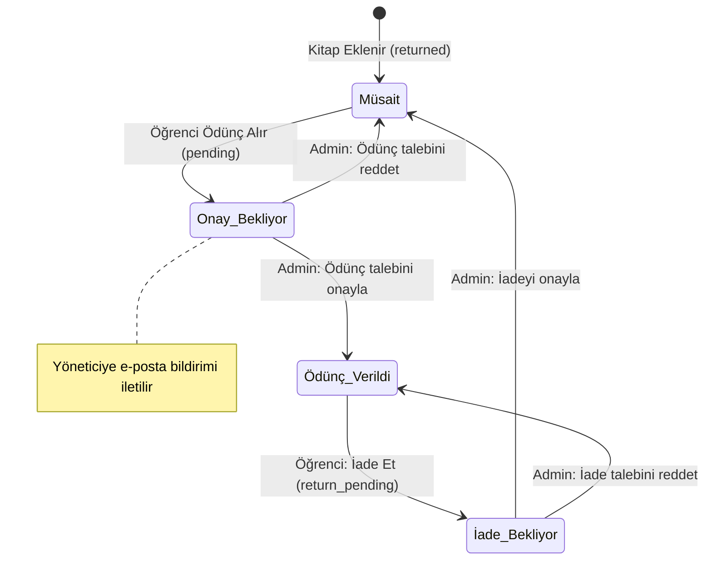

# SKAL Kütüphanesi

Sezai Karakoç Anadolu Lisesi için geliştirilmiş, öğrenci hesap yönetimi, kitap kataloğu, ödünç alma/iade onay mekanizması ve modern yönetim paneli içeren Django tabanlı kütüphane yönetim sistemi.

---

## 📌 Özellikler

- **Öğrenci Hesap Yönetimi:** Herkese açık kayıt kapalıdır; öğrenci hesapları yalnızca okul yöneticisi tarafından Django Admin üzerinden oluşturulur.
- **Kitap Kataloğu & Canlı Arama:** Ziyaretçiler ve öğrenciler tüm kitapları listeyebilir, başlık ve yazara göre anlık arama yapabilir.
- **Ödünç Alma & İade Döngüsü:**
  - Öğrenciler müsait kitaplar için ödünç talebinde bulunabilir.
  - Talep yapıldığında yöneticiye anlık e-posta bildirimi gönderilir.
  - Yönetici Django Admin üzerinden toplu veya tekil olarak talepleri onaylayabilir veya reddedebilir.
  - İade talepleri yönetici onayına düşer; yönetici iadeyi onaylayabilir veya reddederek kitabı öğrencinin zimmetinde tutabilir.
- **Gizlilik:** Giriş yapmamış kullanıcılar yalnızca kitabın müsait veya ödünçte olduğunu görür; kitabı hangi öğrencinin aldığı asla dışarıya sızdırılmaz.
- **Kapak Görseli Desteği:** Kitaplara kapak resmi yüklenebilir; resmi olmayan kitaplar için sade bir yer tutucu gösterilir.
- **Django Unfold Yönetim Paneli:** Modern, ergonomik ve Türkçe admin arayüzü.
- **Sade & Çizgisel Tasarım:** Sıcak kâğıt ve koyu orman yeşili tonlarında minimalist ön yüz.

---

## 🔄 Ödünç ve İade Akış Şeması



---

## 🛠️ Teknolojiler

- **Backend:** Python 3.12+, Django 6.1
- **Admin Teması:** `django-unfold`
- **Görsel İşleme:** `Pillow`
- **Statik Dosya Sunumu:** `WhiteNoise`
- **Veritabanı:** SQLite (Geliştirme) / PostgreSQL uyumlu

---

## 🚀 Kurulum ve Çalıştırma

### 1. Gereksinimler
- Python 3.12 veya üzeri
- `pip` ve `virtualenv`

### 2. Projeyi Klonlayın ve Sanal Ortam Oluşturun
```bash
git clone https://github.com/kullanici/skallibrary.git
cd skallibrary

python -m venv venv
# Windows:
.\venv\Scripts\activate
# Linux / macOS:
source venv/bin/activate
```

### 3. Bağımlılıkları Yükleyin
```bash
pip install -r requirements.txt
```

### 4. Veritabanı Migrasyonlarını Uygulayın
```bash
python manage.py migrate
```

### 5. Yönetici (Admin) Hesabı Oluşturun
```bash
python manage.py createsuperuser
```

### 6. Geliştirme Sunucusunu Başlatın
```bash
python manage.py runserver
```

Tarayıcınızdan erişin:
- **Katalog & Ana Sayfa:** `http://127.0.0.1:8000/`
- **Yönetim Paneli:** `http://127.0.0.1:8000/admin/`

---

## 🧪 Testleri Çalıştırma

Tüm iş mantığı, admin aksiyonları, e-posta bildirimleri ve yetkilendirme kuralları birim testlerle kapsanmıştır:

```bash
python manage.py test
```

---

## 🌐 Canlıya (Production) Geçiş

Canlı ortama geçmeden önce `.env.example` dosyasını referans alarak `.env` dosyanızı oluşturun ve gerekli değişkenleri tanımlayın:

```ini
DJANGO_SECRET_KEY=guclu-ve-rastgele-bir-secret-key-en-az-50-karakter
DJANGO_DEBUG=False
DJANGO_ALLOWED_HOSTS=kutuphane.skal.k12.tr
DJANGO_CSRF_TRUSTED_ORIGINS=https://kutuphane.skal.k12.tr

# E-posta (SMTP)
DJANGO_ADMIN_EMAIL=admin@skal.k12.tr
DJANGO_DEFAULT_FROM_EMAIL=noreply@skal.k12.tr
DJANGO_EMAIL_BACKEND=django.core.mail.backends.smtp.EmailBackend
DJANGO_EMAIL_HOST=smtp.gmail.com
DJANGO_EMAIL_PORT=587
DJANGO_EMAIL_USE_TLS=True
DJANGO_EMAIL_HOST_USER=kutuphane@skal.k12.tr
DJANGO_EMAIL_HOST_PASSWORD=uygulama-sifresi
```

Statik dosyaları derlemek için:
```bash
python manage.py collectstatic --noinput
```

---

## 📄 Lisans

Bu proje AGPLv3 lisansı ile lisanslanmıştır. Detaylar için [LICENSE](LICENSE) dosyasına göz atabilirsiniz.
