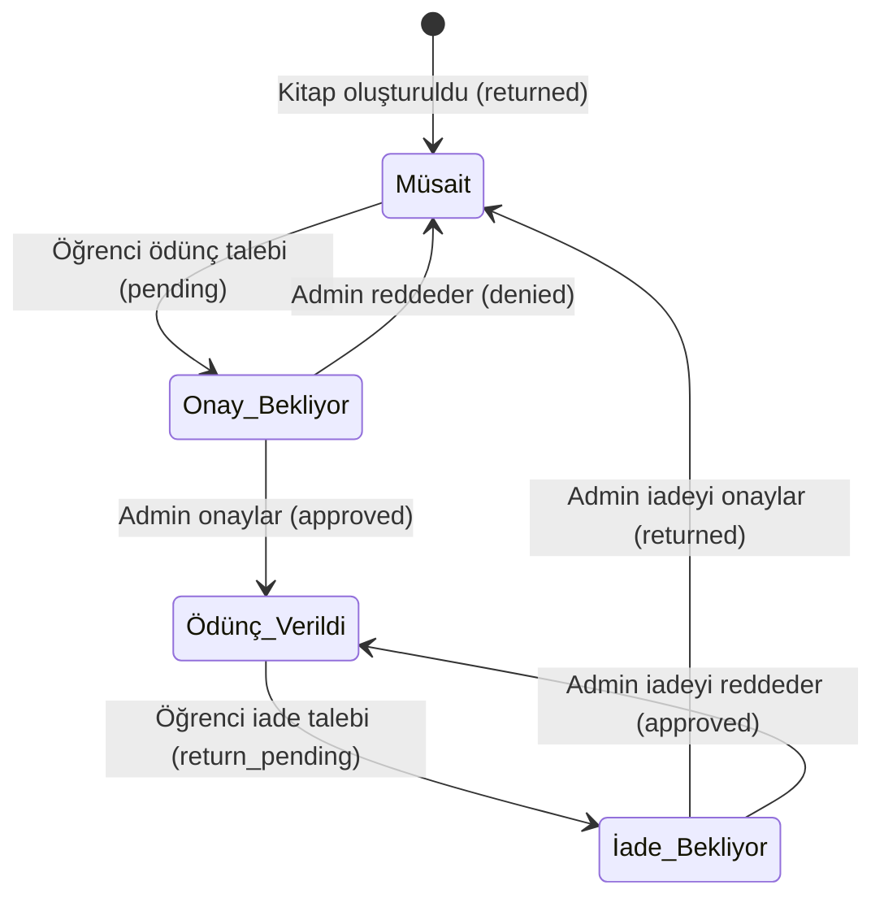

# SKAL Kütüphanesi

Sezai Karakoç Anadolu Lisesi kütüphane yönetim sistemi. Öğrenci ödünç/iade onay döngüsü, kitap kataloğu ve Django admin yönetimini sağlar.

## Akış Şeması



## Kurulum ve Çalıştırma

```bash
python -m venv venv
source venv/bin/activate  # Windows: .\venv\Scripts\activate
pip install -r requirements.txt
python manage.py migrate
python manage.py createsuperuser
python manage.py runserver
```

- Katalog: `http://127.0.0.1:8000/`
- Yönetim paneli: `http://127.0.0.1:8000/admin/`

## Docker ile Çalıştırma

```bash
cp .env.example .env
# .env dosyasındaki değişkenleri düzenleyin

docker compose up -d
```

- Medya dosyaları (`./media`) ve SQLite veritabanı (`./data`) ana makinede kalıcı olarak saklanır.
- Konteyner ayağa kalktığında veritabanı geçişleri (`migrate`) otomatik uygulanır.

## Testler

```bash
python manage.py test
```

## Canlı Ortam Yapılandırması

Canlıya çıkarken `.env.example` dosyasını `.env` olarak kopyalayıp üretim değişkenlerini tanımlayın:

```bash
cp .env.example .env
python manage.py collectstatic --noinput
```

`DJANGO_DEBUG=False` olduğunda HTTPS, HSTS, secure cookies ve WhiteNoise statik sunumu otomatik devreye girer.

GitHub Actions (`.github/workflows/ci.yml`), `main` dalına gelen her push işleminde testleri çalıştırır ve Docker imajını `ghcr.io` üzerine `latest` etiketiyle yükler.

## Lisans

AGPL-3.0. Detaylar için [LICENSE](LICENSE).
